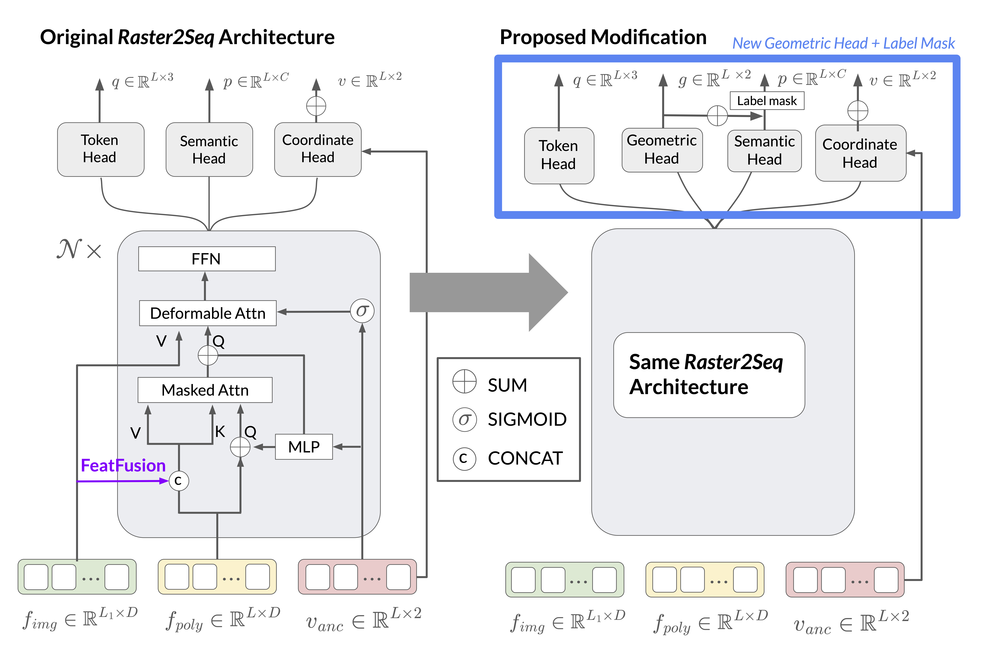

# Vectorizing-Raster-Maps

Jennah Gosciak (jrg377), Minsung Kim (mk2797), Sunishka Sil (ss4469)

The next few sections describe the setup of the repository, installation, and how to work with a virtual machine using Google Cloud. Note: many of the methods in this repository rely on an updated version of a [forked Raster2Seq repository](https://github.com/jennahgosciak/Raster2Seq).

**Proposed architecture changes/contribution:** A high level overview of our decoder architecture (contrasted with the original Raster2Seq architecture) is shown here. These changes have been made directly to the forked repository shown above.


Skip to the [Training](#training) section to understand how to train and evaluate the models.

*Note: Generative AI is statement [here](#generative)*

## Installation

- Clone [Raster2Seq](https://github.com/Cornell-VAILab/Raster2Seq) next to this repo (`../Raster2Seq`), at the commit this project is tested with:
  ```shell
  git clone https://github.com/Cornell-VAILab/Raster2Seq.git ../Raster2Seq
  git -C ../Raster2Seq checkout a6c4e27   # 2026-06-02
  ```
- Create an environment:
  ```shell
  conda create -n raster2seq python=3.10
  conda activate raster2seq
  ```
- Install pytorch and required libraries:
  ```shell
  # adjust the cuda version accordingly (omit --index-url on macOS / CPU)
  pip install torch==2.3.1 torchvision==0.18.1 torchaudio==2.3.1 --index-url https://download.pytorch.org/whl/cu118
  pip install -r requirements.txt
  ```
- For training (GPU only), compile Raster2Seq's CUDA ops as described in its README.

## Setting up the VM (Google Cloud)
Create the VM with the GPU attached (GPU quota needed; T4/L4/V100 on N1/G2, A100 on A2).
### 1. NVIDIA driver
Check first: `nvidia-smi`. If it fails, install the driver. 

On a Deep Learning VM image: `sudo /opt/deeplearning/install-driver.sh`.
Otherwise:
```bash
curl -L https://raw.githubusercontent.com/GoogleCloudPlatform/compute-gpu-installation/main/linux/install_gpu_driver.py -o install_gpu_driver.py
sudo python3 install_gpu_driver.py
sudo reboot
```
After reboot, `nvidia-smi` should list the GPU.

### 2. Conda + env
The system Python (3.13) is not used; the env has its own Python 3.10.
```bash
wget https://repo.anaconda.com/miniconda/Miniconda3-latest-Linux-x86_64.sh
bash Miniconda3-latest-Linux-x86_64.sh -b -p $HOME/miniconda3
eval "$($HOME/miniconda3/bin/conda shell.bash hook)" && conda init

conda create -n raster2seq python=3.10 -y
conda activate raster2seq
which python   # ~/miniconda3/envs/raster2seq/bin/python
```

### 3. Repos

Important: ensure that the (forked) Raster2Seq repository is stored adjacent to the 
```bash
cd ~
git clone https://github.com/jennahgosciak/Raster2Seq.git
git clone <vectorizing-raster-maps repo URL>
```

### 4. Packages
```bash
pip install torch==2.3.1 torchvision==0.18.1 torchaudio==2.3.1 --index-url https://download.pytorch.org/whl/cu121
pip install -r ~/vectorizing-raster-maps/requirements.txt
sudo apt-get install -y libcairo2          # for CairoSVG / render_omt.py
nvcc --version || conda install -c nvidia cuda-toolkit=12.1 -y   # CUDA compiler for step 5
pip check
```

### 5. Attention setup
```bash
pip install ninja  # the build fails without it
cd ~/Raster2Seq/models/ops && sh make.sh && cd ~
python -c "import torch, MultiScaleDeformableAttention; print(torch.cuda.is_available(), torch.version.cuda)"   # True 12.1
```

### 6. Initializing wandb
```bash
wandb login   # paste the API key
```
`main_ddp.py` saves the key to `wandb_keys/<user>_wandb.key` in the folder it runs from; keep `wandb_keys/` in `.gitignore`.

### 7. Data
Data is not in git. It should be transferred via scp:
```bash
gcloud compute scp data/coco_osm_mini.zip <vm-name>:~/vectorizing-raster-maps/data/ --zone <zone>
```
Then `unzip` it on the VM.

Optional: `plotly_get_chrome` to save `plot_floor.py --compute_stats` histograms.


## Data processing

### 1. Get the crops folder

`crops/` holds one pair of files per map crop:
- `<name>.geojson.gz` – OpenMapTiles vector features for the crop
- `<name>.png` – the rendered map image

Unzip `crops.zip` into `crops/`, or regenerate the crops from OpenStreetMap with `data_preprocess/osm_crops.py` (see the instructions at the top of that file).

### 2. Convert to Raster2Seq's COCO format

```shell
conda activate raster2seq
python data_preprocess/create_coco_osm.py --data_root crops --output data/coco_osm
```

By default, line features remain lines. To convert line features (such as roads,
railways, and waterways) into buffered polygons, pass a positive buffer radius in
the original PNG's pixel units:

```shell
python data_preprocess/create_coco_osm.py --data_root crops \
  --output data/coco_osm_buffer --line_buffer_px 2
```

For example, a radius of 2 pixels extends approximately 2 pixels on each side of
a line. Use a separate output directory to keep buffered and unbuffered datasets.
Buffered lines are saved as polygons with their original category labels. In a
buffered run, annotations also include `source_geom_type` to record whether the
original geometry was a `line` or `polygon`. Without buffering, that field is not
added. Buffered polygons are also subject to `--min_area` and `--simplify_tol`.

This writes the layout Raster2Seq expects, which is a COCO annotation layout:
```
data/coco_osm/
├── train/  val/  test/                 # PNGs
└── annotations/
    └── train.json  val.json  test.json # COCO annotations (polygons and lines in PNG pixels)
```

Splits: crops whose name starts with `<test_borough>_` form the test set; val is `--val_frac` of all crops, taken from the rest.

**Flushing test set.** The current data (`crops_flushing/` → `data/coco_osm_flushing`) is all Queens, with
Flushing held out for testing. `make_boxes.py --test-nta flushing` names the boxes inside the Flushing NTAs
`flushing_*` and keeps every other box from touching those NTAs; `--test_borough flushing` then sends
exactly those crops to test:

```shell
python data_preprocess/make_boxes.py --n 2400 --min-m 125 --max-m 125 --boroughs queens \
  --test-frac 0.0834 --test-nta flushing --out data/nyc_boxes_flushing.csv
python data_preprocess/create_coco_osm.py --data_root crops_flushing --output data/coco_osm_flushing \
  --test_borough flushing
```

Test boxes only need their center inside Flushing, so a few reach past its edge and slightly overlap train crops.

Options:
- `--test_borough` – name prefix of the test crops, e.g. `flushing` (default `queens`)
- `--val_frac` – val size as a fraction of all crops (default `0.1`)
- `--min_area` – drop polygons smaller than this, in px² (default `20`)
- `--simplify_tol` – shape simplification tolerance in px, `0` = off (default `1.0`)
- `--line_buffer_px` – buffer radius in original PNG pixels for line features; must be positive (default: no buffering)

### 3. Defining labels

Labels come from the fixed vocabulary `VOCAB` in `create_coco_osm.py` (e.g. `street`, `building`, `park`). Anything not listed becomes `unknown` / `unknown_line`. When training with labels, set `--semantic_classes` to the number of labels + 1. We hand-reviewed the vocabulary.

`data/coco_osm/` is a large folder and can be regenerated with the command above. It is not tracked and should be included in the `.gitignore.`

Files in `_scratch` include ad-hoc work and additional testing. These should not be reviewed.


## Training

Importantly, all training and evaluation functions call methods directly from Raster2Seq. Ensure you have the correct [forked repository](https://github.com/jennahgosciak/Raster2Seq).

All training of the Raster2Seq models is done via bash scripts stored in `tools/`. We separate scripts into model-specific folders and differentiate between training and evaluation. Raster2Seq is trained in two stages: `train_*.sh` scripts implement the first stage of training while `finetune_*.sh` implement the second stage.

1. `tools/train_osm.sh`: stage 1 for the modified Raster2Seq model, which learns shapes only (polygon vs. line).
2. `tools/finetune_osm.sh`: stage 2, starts from stage 1 and learns the semantic labels along with an additional attention head.

The color-threshold baseline does not need explicit training and can be found in the `baselines/` folder.

## Evaluation

- `predict_and_evaluate.sh` (stage 1) and `predict_and_evaluate_stage2.sh`: run the Raster2Seq `eval.py` on a checkpoint
- `parallel_evaluation.sh`: same process as above, but splits the set of images into K parts to speed up evaluation. Evaluates images in in parallel and then combines them. Each part is weighted by the number of images in which it appears.
- `create_latex_table.py`: turns the results into LaTeX tables that we can paste into the report.

The color threshold baseline has its own evaluation script `eval_baseline.py`.

### Generative AI Statement
Claude Code (Opus 5.5) and ChatGPT (GPT 6.2 Astra) assisted with writing code and debugging errors.
